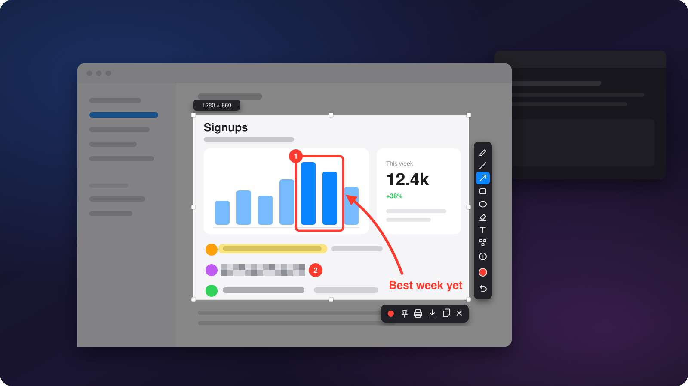

<p align="center">
  
</p>

<h1 align="center">Photon</h1>

<p align="center">
  <b>Screenshots, markup and screen recording, in one tiny native app.</b><br>
  Press a key, drag, done.
</p>

<p align="center">
  
  
  
  <a href="LICENSE.md"></a>
</p>

<p align="center">
  <a href="https://github.com/piedol/photon/releases/latest/download/Photon-macOS-arm64.zip"></a>
  &nbsp;
  <a href="https://github.com/piedol/photon/releases/latest/download/Photon-windows-x64.zip"></a>
</p>

<p align="center">
  <sub>Free for personal use · <a href="https://github.com/piedol/photon/releases">All releases</a> · <a href="#install">Install help</a></sub>
</p>

<p align="center">
  
</p>

---

## Download

Get the latest version from the [Releases page](https://github.com/piedol/photon/releases/latest), or use the buttons above.

| Your computer | Download | Works on |
|---|---|---|
| **Mac** | [Photon-macOS-arm64.zip](https://github.com/piedol/photon/releases/latest/download/Photon-macOS-arm64.zip) | Macs with Apple silicon (M1 or newer), macOS 15 or later |
| **Windows PC** | [Photon-windows-x64.zip](https://github.com/piedol/photon/releases/latest/download/Photon-windows-x64.zip) | Windows 10 (version 1903 or later) and Windows 11, 64-bit |

Not sure which Mac you have? Open the Apple menu › **About This Mac**. If it says **Chip: Apple M1** (or M2, M3, M4 and so on), Photon will run on it.

## Install

**On a Mac**
1. Open the downloaded zip, then drag **Photon** into your **Applications** folder.
2. Open Photon. If macOS says it can't check the app, go to **System Settings › Privacy & Security** and click **Open Anyway**.
3. When asked, allow **Screen & System Audio Recording**.
4. Photon's icon appears in the menu bar. Press **⇧⌘9** to take your first screenshot.

**On Windows**
1. Open the downloaded zip and copy **Photon.exe** anywhere you like, such as your Desktop or a Programs folder.
2. Double-click it. If Windows SmartScreen appears, click **More info › Run anyway**.
3. Photon's icon appears in the notification area by the clock. Press **Ctrl+Shift+9** to take your first screenshot.

To have Photon start with your computer, click its icon and turn on **Launch at Login**.

## How it works

<table>
<tr>
<th width="50%">Take a screenshot</th>
<th width="50%">Record your screen</th>
</tr>
<tr>
<td valign="top">

1. Press **⇧⌘9** (Windows: **Ctrl+Shift+9**). The screen freezes.
2. Drag over what you want, or click a window.
3. Draw on it if you like.
4. Press **Return**. It's on your clipboard, ready to paste.

</td>
<td valign="top">

1. Press **⇧⌘0** (Windows: **Ctrl+Shift+0**).
2. Drag a region, or click a window.
3. Press **Return** to start recording.
4. Press the shortcut again to stop. Your video is saved, with buttons to share, trim or make a GIF.

</td>
</tr>
</table>

Changed your mind? **Esc** cancels at any point before recording starts. There are no accounts, sign-ups or windows to manage.

## Features

### Capture
- **Freeze-frame screenshots** of every screen at full resolution, so what you mark up is exactly what was there.
- **Click any window** to select it precisely, or click the desktop for the whole screen.
- **Fine-tune** with drag handles or the arrow keys. A live badge shows the exact size in pixels.
- **Finish your way:** copy, save as PNG or JPEG, print, or **pin** the screenshot so it floats above your other windows.

### Markup
- **Pen, line, arrow, rectangle, ellipse, highlighter and text.** Hold Shift for straight lines, squares and circles.
- **Pixelate** passwords, emails and anything else private before you share.
- **Numbered steps** (1, 2, 3…) for quick how-to guides.
- **Eight colours plus any custom colour**, and three stroke sizes on `[` `]` or the scroll wheel.
- Everything stays crisp on high-resolution screens.

### Record
- **A region, a whole screen, or a single window.** Pick a window and only that window is recorded, even if something else covers it.
- **Smooth 60 fps video** using your computer's hardware encoder (H.264, or HEVC for smaller files), written straight to disk.
- **System audio, your microphone and a webcam bubble**, each one click away.
- **Click highlights** so viewers can follow along.
- **Countdown with Skip**, plus **pause and resume** while recording.

### Share
After every recording, a small panel gives you one-click access to:
- **Copy file**, which pastes straight into chat apps, email or a folder.
- **Trim** the start and end, instantly and without losing quality.
- **Make GIF**: a looping GIF for chats, docs and issue trackers.
- **Show in folder** and **Open**.

### Save
- **Screenshots go to the clipboard** by default. Turn on auto-save to also keep a copy in a folder.
- **Recordings go to your Movies or Videos folder**, or anywhere you choose.
- **Cloud sync without another account:** Photon finds your OneDrive, Google Drive, Dropbox, Box and iCloud Drive folders. Pick one and the provider's own app uploads your files.
- **Name files your way** with templates for date, time, app name, size and a counter, with a live preview.

### Light and private
- **Under 1 MB.** Photon is a single native program with no bundled browser or runtime.
- **Fast:** the capture screen appears in a fraction of a second.
- **Nothing running in the background.** Each capture is created when you press the key and released when you're done.
- **No network code at all.** No accounts, analytics, uploads or update checks. Your files go only where you put them.

## Keyboard shortcuts

| Mac | Windows | What it does |
|---|---|---|
| **⇧⌘9** | **Ctrl+Shift+9** | Take a screenshot (also stops a recording) |
| **⇧⌘0** | **Ctrl+Shift+0** | Start recording, or stop it |
| **Return** | **Enter** | Copy the screenshot, or start recording |
| **Esc** | **Esc** | Cancel |
| **⌘C · ⌘S · ⌘P · ⌘Z** | **Ctrl+C · S · P · Z** | Copy · Save · Print · Undo |
| **Arrow keys** | **Arrow keys** | Move the selection (Shift for 10 px, ⌥ or Alt to resize) |
| **Shift** while drawing | **Shift** while drawing | Straight lines, squares and circles |
| **[ ]** or scroll | **[ ]** or scroll | Change stroke size |

Both main shortcuts can be changed in **Settings › General**. Photon can also be driven from scripts and launchers with `photon://capture`, `photon://record` and `photon://stop` links.

## Build from source

**Mac** (needs Rust and the Xcode command line tools):

```bash
scripts/bundle.sh --install
```

**Windows** (needs Rust with the MSVC toolchain and Visual Studio Build Tools):

```powershell
cd windows
cargo build --release
```

See [Quickstart](docs/quickstart.md) and [Photon for Windows](docs/windows.md) for details.

## Documentation

| Page | What it covers |
|---|---|
| [Quickstart](docs/quickstart.md) | Building, installing, first launch and permissions on a Mac |
| [Usage](docs/usage.md) | Screenshots, markup, pins, recording, trim, GIFs, every key and button |
| [Configuration](docs/configuration.md) | Every setting, naming templates and environment variables |
| [Photon for Windows](docs/windows.md) | The Windows edition: install, differences, storage, building |
| [Interfaces](docs/interfaces.md) | Global shortcuts, overlay keys and `photon://` links |
| [Storage](docs/storage.md) | Where files, settings and temporary data live |
| [Permissions](docs/permissions.md) | macOS privacy permissions and signing |
| [Security & privacy](docs/security.md) | What Photon can see and what leaves your computer |
| [Architecture](docs/architecture.md) | Modules, the capture and recording pipelines, memory |
| [Development](docs/development.md) | Tests, lint, self-tests and project layout |
| [Deployment](docs/deployment.md) | Bundling, signing, releases and uninstalling |
| [Troubleshooting](docs/troubleshooting.md) | Common problems and what to check |

## License

Photon is source-available under the [PolyForm Noncommercial License 1.0.0](LICENSE.md).

- **Free** for personal, hobby, research and educational use, and for nonprofits, schools and government.
- **Forks and changes** are welcome for those same purposes.
- **Not for commercial use**, including use inside a company, without a separate license.
- **Credit is required.** Anyone who shares Photon or a fork must include the license and this notice, unchanged:

  > Required Notice: Copyright (c) 2026 piedol (https://github.com/piedol/photon)

For commercial licensing, contact [piedol](https://github.com/piedol).

---

<details>
<summary><sub>Docs update tag</sub></summary>

Docs last updated: `docs-2026-10-24-4`

Docs audited through commit: `8613f8f`

This tag marks the last commit where `README.md` and `docs/` were audited and updated.
- View changes since the docs were last updated: `git log docs-2026-10-24-4..HEAD --oneline`
- Diff the docs against now: `git diff docs-2026-10-24-4..HEAD -- README.md docs/`

Update procedure:
1. Pick a new tag name like `docs-YYYY-MM-DD`, or `docs-YYYY-MM-DD-2` if you've already used today's tag.
2. Before changing any docs, set `Docs audited through commit` to the code commit you're auditing: `git rev-parse --short HEAD`.
3. Update the `Docs last updated` line in the same commit as your docs changes.
4. Commit with: `docs: sync docs (docs-YYYY-MM-DD)`.
5. Create the annotated tag: `git tag -a docs-YYYY-MM-DD -m "docs: sync docs"`.
6. Push the tag: `git push origin docs-YYYY-MM-DD`.

</details>
