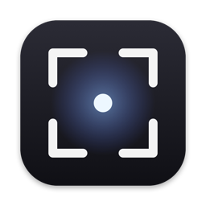
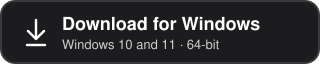
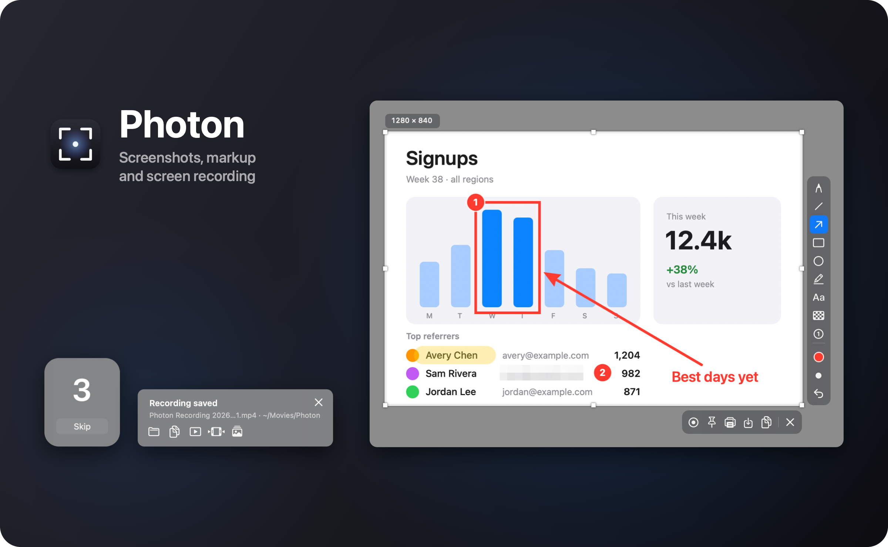
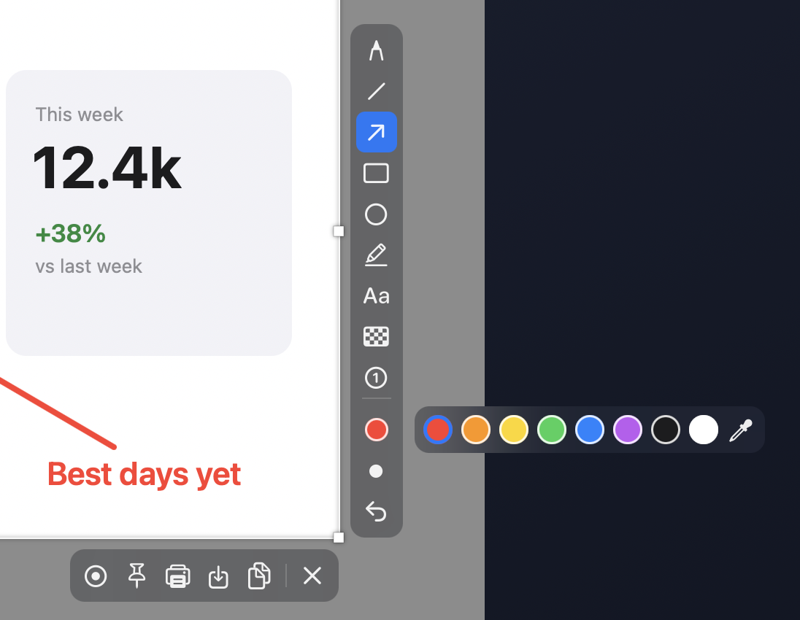
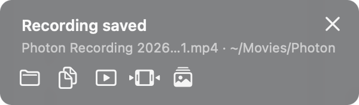
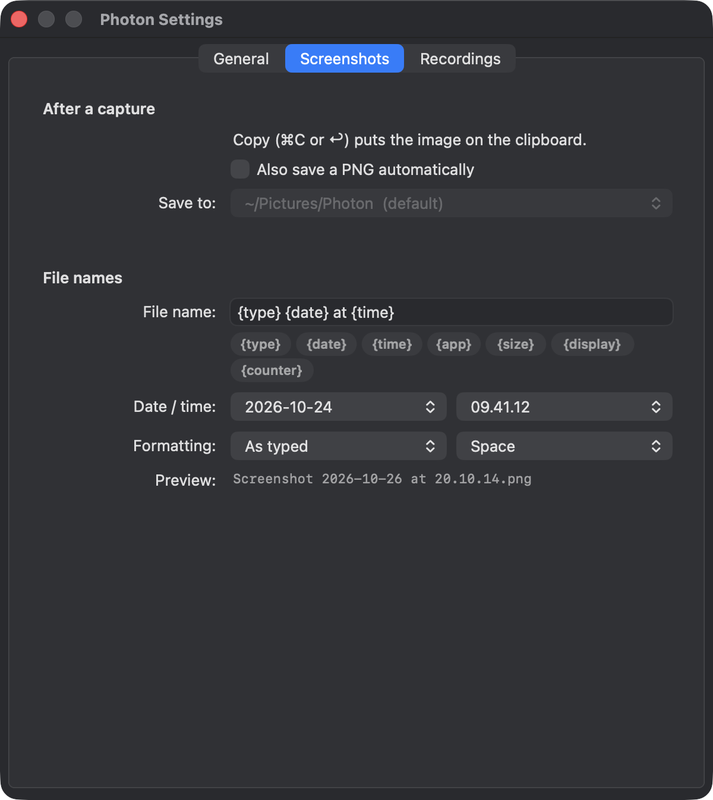

<p align="center">
  
</p>

<h1 align="center">Photon</h1>

<p align="center">
  Screenshots, markup and screen recording for macOS and Windows, written in Rust.
</p>

<p align="center">
  <a href="https://github.com/piedol/photon/releases/latest"></a>
  
  
  <a href="LICENSE"></a>
</p>

<p align="center">
  <a href="https://github.com/piedol/photon/releases/latest/download/Photon-macOS-arm64.zip"></a>
  &nbsp;
  <a href="https://github.com/piedol/photon/releases/latest/download/Photon-windows-x64.zip"></a>
</p>

<p align="center">
  
</p>

Photon takes screenshots and screen recordings from the menu bar. Press **⇧⌘9** (Windows: **Ctrl+Shift+9**) and the screen freezes while you select an area, mark it up and copy it. **⇧⌘0** records a region, a window or a whole screen at 60 fps, and afterwards you can trim the recording or turn it into a GIF.

The program file is 824 KB on the Mac and 1.1 MB on Windows. On the Mac, Photon uses about 12 MB of memory at launch and about 45 MB after the first capture. It makes no network connections.

Photon is in English, Simplified Chinese, Japanese, German, French, Spanish, Brazilian Portuguese and Korean, and follows your system language. On a Mac you can set Photon's language in System Settings › General › Language & Region › Applications.

## Contents

- [Download](#download)
- [Taking a screenshot](#taking-a-screenshot)
- [Recording your screen](#recording-your-screen)
- [Saving and sharing](#saving-and-sharing)
- [Keyboard shortcuts](#keyboard-shortcuts)
- [Privacy](#privacy)
- [Build from source](#build-from-source)
- [Documentation](#documentation)
- [Contributing](#contributing) · [Credits](#credits) · [License](#license)

## Download

| Computer | Download | Requirements |
|---|---|---|
| Mac | [Photon-macOS-arm64.zip](https://github.com/piedol/photon/releases/latest/download/Photon-macOS-arm64.zip) | Apple silicon (M1 or later), macOS 15 or later |
| Windows PC | [Photon-windows-x64.zip](https://github.com/piedol/photon/releases/latest/download/Photon-windows-x64.zip) | Windows 10 (version 1903 or later) or Windows 11, 64-bit |

To check your Mac, open the Apple menu › **About This Mac**. Photon runs on it if the Chip line says Apple M1 or later.

**Mac**

1. Open the zip and drag **Photon** into your **Applications** folder.
2. Open Photon and confirm that you want to open an app downloaded from the internet. It's signed and notarized by Apple, so macOS doesn't ask you to approve it in Privacy & Security.
3. Allow **Screen & System Audio Recording** when macOS asks.
4. Photon's icon appears in the menu bar. Press **⇧⌘9** to take your first screenshot.

**Windows**

1. Open the zip and copy **Photon.exe** anywhere you like, such as your Desktop or a Programs folder.
2. Double-click it. If SmartScreen appears, click **More info › Run anyway**.
3. Photon's icon appears in the notification area by the clock. Press **Ctrl+Shift+9** to take your first screenshot.

To start Photon with your computer, turn on **Launch at Login** in its menu (on Windows, right-click the tray icon).

To remove Photon, see [Uninstalling](docs/deployment.md#uninstalling) for the Mac or [Photon for Windows](docs/windows.md#uninstalling). If something doesn't work, start with [Troubleshooting](docs/troubleshooting.md).

## Taking a screenshot

<p align="center">
  
</p>

1. Press **⇧⌘9** (Windows: **Ctrl+Shift+9**). Your screens freeze at full resolution.
2. Drag over an area, click a window to select it, or click the desktop for the whole screen. Adjust the selection with the handles or the arrow keys. A badge shows its size in pixels.
3. Mark it up if you like.
4. Press **Return** to copy it, or use the action bar to save it as PNG or JPEG, print it, or pin it above your other windows.

Press **Esc** to cancel at any point.

The markup tools are a pen, line, arrow, rectangle, ellipse, highlighter and text, plus **Pixelate** for hiding passwords and email addresses, and **numbered steps** (1, 2, 3…) for how-to guides. Hold Shift for straight lines, squares and circles. There are eight colours and a custom colour picker, and three stroke sizes on `[` and `]` or the scroll wheel.

## Recording your screen

<p align="center">
  
</p>

1. Press **⇧⌘0** (Windows: **Ctrl+Shift+0**).
2. Drag a region, or click a window or a screen. When you pick a window, Photon records only that window, even if something covers it.
3. Press **Return**. A countdown starts, which you can skip.
4. Press the shortcut again to stop.

Recordings are 60 fps H.264, or HEVC for smaller files, encoded in hardware and written straight to disk. System audio is recorded by default. You can add your microphone and a webcam bubble (not available when recording a window), highlight your clicks, and pause and resume.

When you stop, a panel offers **Copy file** (which pastes straight into chat apps and email), **Open**, **Trim** (cuts the start and end without re-encoding), **Make GIF** (a looping 12 fps GIF of the first 60 seconds, up to 960 px wide) and **Show in Finder**.

## Saving and sharing

<p align="center">
  
</p>

- Screenshots go to the clipboard. Turn on auto-save to also keep a copy in a folder.
- Recordings go to your Movies (Windows: Videos) folder, or a folder you choose.
- Photon finds your OneDrive, Google Drive, Dropbox, Box and iCloud Drive folders. Save to any of them and the provider's app uploads the files. Photon never signs in to anything.
- File names follow a template with tokens for the date, time, app name, size and a counter, with a live preview.

## Keyboard shortcuts

| Mac | Windows | Action |
|---|---|---|
| **⇧⌘9** | **Ctrl+Shift+9** | Take a screenshot (also stops a recording) |
| **⇧⌘0** | **Ctrl+Shift+0** | Start a recording, or stop it |
| **Return** | **Enter** | Copy the screenshot, or start recording |
| **Esc** | **Esc** | Cancel |
| **⌘C · ⌘S · ⌘P · ⌘Z** | **Ctrl+C · S · P · Z** | Copy · Save · Print · Undo |
| **Arrow keys** | **Arrow keys** | Move the selection (Shift for 10 px; ⌥ or Alt to resize) |
| **Shift** while drawing | **Shift** while drawing | Straight lines, squares and circles |
| **[ ]** or scroll | **[ ]** or scroll | Change the stroke size |

Both main shortcuts can be changed in **Settings › General**. Scripts and launchers can drive Photon with `photon://capture`, `photon://record` and `photon://stop` links.

## Privacy

- Photon captures the screen only when you press a shortcut, and records only between Record and Stop.
- The microphone and camera are used only during a recording, and only when you turn them on.
- Photon makes no network connections. It has no analytics or crash reporting and doesn't check for updates.
- Your files go only where you save or paste them.
- Pixelation is burned into the exported image, and the original pixels aren't kept.

[Security & privacy](docs/security.md) has the details.

## Build from source

On a Mac, with Rust and the Xcode Command Line Tools:

```bash
git clone https://github.com/piedol/photon.git
```

```bash
cd photon && scripts/bundle.sh --install
```

On Windows, with Rust (MSVC toolchain) and the Visual Studio Build Tools:

```powershell
cd windows
cargo build --release
```

See the [Quickstart](docs/quickstart.md) and [Photon for Windows](docs/windows.md) for details.

## Documentation

| Page | Covers |
|---|---|
| [Quickstart](docs/quickstart.md) | Building, installing, first launch and permissions on a Mac |
| [Usage](docs/usage.md) | Screenshots, markup, pins, recording, trimming and GIFs, with every key and button |
| [Configuration](docs/configuration.md) | Every setting, file name templates and environment variables |
| [Photon for Windows](docs/windows.md) | The Windows edition: installing, differences, storage and building |
| [Interfaces](docs/interfaces.md) | Global shortcuts, overlay keys and `photon://` links |
| [Storage](docs/storage.md) | Where files, settings and temporary data live |
| [Permissions](docs/permissions.md) | macOS privacy permissions and signing |
| [Security & privacy](docs/security.md) | What Photon can see and what leaves your computer |
| [Architecture](docs/architecture.md) | Modules, the capture and recording pipelines, and memory |
| [Development](docs/development.md) | Tests, lint, self-tests and the project layout |
| [Deployment](docs/deployment.md) | Bundling, signing, releases and uninstalling |
| [Troubleshooting](docs/troubleshooting.md) | Common problems and what to check |

## Contributing

Bug reports and pull requests are welcome. Before opening a pull request, run `cargo test` and `cargo clippy` (and the same in `windows/` for changes to the Windows edition). [Development](docs/development.md) describes the project layout and the self-tests.

## Credits

On macOS, Photon calls Apple's frameworks through [objc2](https://github.com/madsmtm/objc2) and registers its shortcuts with [global-hotkey](https://github.com/tauri-apps/global-hotkey). The Windows edition uses the [windows](https://github.com/microsoft/windows-rs) crate, [windows-capture](https://github.com/NiiightmareXD/windows-capture) and [wasapi](https://github.com/HEnquist/wasapi-rs).

## License

Copyright 2026 piedol.

Photon is free software under the [GNU General Public License v3.0 or later](LICENSE). You can use, study, share and change it, including at work. If you distribute a modified version, you must release its source under the same license.
